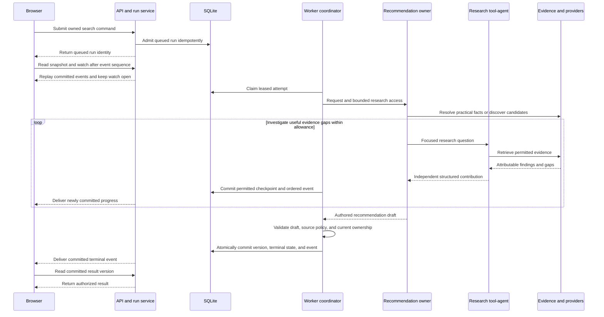

# GobbleGobble architecture and ownership

This reference records the proposed architecture for GG-001.04. The [product contract](PRODUCT.md) sets its scope, and the [integration findings](INTEGRATIONS.md) constrain source use. GG-001.04 is implemented, awaiting section verification at GG-003. GG-002.01 adds the [backend environment](BACKEND_SETUP.md). GG-002.02 adds the [local settings boundary](SETTINGS.md) in `app/core/settings.py`. GG-002.03 adds [bounded calls and safe receipts](CALLS.md) in `app/core/calls.py`. GG-002.04 adds the [location/discovery client](GEOGRAPHY_PROBES.md) in `app/providers/geoapify.py`. GG-002.05 adds [walking/driving route requests](ROUTE_PROBES.md) to the same client. GG-002.06 adds the [web-research client](WEB_RESEARCH_PROBES.md) in `app/providers/web_research.py`. No API, database, worker, or agent exists yet. This document describes their intended ownership, not measured behavior.

## Fixed design and starting assumptions

The agreed stack is a Python backend, a SvelteKit frontend, and SQLite on one local host. The frontend, API, and worker are separate local processes. Single-host operation and English output are starting assumptions. Research can use local-language sources and preserve local place names. Neither assumption creates a geographic whitelist.

One adaptive recommendation owner decides which evidence gaps to investigate and authors the final comparisons. A bounded place research agent returns evidence through the actual OpenAI Agents SDK agent-as-tool mechanism. The owner keeps final-answer responsibility. There is no cuisine hierarchy or specialist handoff tree.

Backend code owns durable execution and permission enforcement. The model owner cannot grant source permission, extend its execution allowance, or publish directly. The browser owns interaction and presentation. Provider credentials and model execution stay in Python.

Accounts, open-ended chat, future-date planning, deployment, and CartCart shopping features remain outside this design. The normal delivered app uses real services. Controlled jobs support the foundation gate without becoming a silent fixture fallback.

## Planned module map

The module paths below remain proposed except for `apps/backend/app/core/settings.py`, `apps/backend/app/core/calls.py`, `apps/backend/app/providers/geoapify.py`, `apps/backend/app/providers/web_research.py`, and their package markers. GG-002.01 creates the parent `apps/backend/app/` package and the `scripts/local/init-backend.sh` environment command. GG-002.02 implements settings and credential preflight. GG-002.03 implements call admission, shared request/time bounds, and metadata receipts. GG-002.04 implements bounded Geoapify location/discovery requests using that same attempt configuration. GG-002.05 adds route estimates and explicit unavailable outcomes under the same bounds. GG-002.06 prepares bounded OpenAI Responses web search with ephemeral citation-bearing results. The ownership boundaries are the design contract. Later implementation tasks can choose filenames within those boundaries. The table does not describe implemented application interfaces.

| Planned location | Responsibility | Implementation tasks |
|---|---|---|
| `apps/backend/app/core/` | Local settings, credential preflight, execution limits, and safe diagnostics. | GG-002.01 through GG-002.03, GG-024.01 |
| `apps/backend/app/schemas/` | Authoritative request, place, evidence, result, version, lifecycle, and API contracts. | GG-004.01 through GG-004.05 |
| `apps/backend/app/db/` | SQLite setup, migrations, repositories, leases, independent contributions, ordered events, and atomic commits. | GG-005.01 through GG-005.05, GG-013.03 |
| `apps/backend/app/api/` and `apps/backend/app/services/runs.py` | Anonymous access, command admission, status reads, event replay followed by live SSE, and user commands. | GG-005.02 through GG-005.07, GG-013.04, GG-016.02, GG-018 |
| `apps/backend/app/worker/` | Claim attempts, enforce leases and cumulative limits, drive work, and coordinate checkpoint and publication writes. | GG-005.04, GG-005.08, GG-013.01, GG-018 |
| `apps/backend/app/providers/` | Capability-specific location, discovery, route, and web clients with source identity and safe call receipts. Probes reuse these clients. | GG-002.04 through GG-002.08, GG-008 |
| `apps/backend/app/evidence/` | Source-use guards, food and review interpretation, freshness, retention, source lookup, and invalidation of dependent data. | GG-009 |
| `apps/backend/app/research/` | Broader research snapshots, candidate lookup, evidence gaps, and reuse across attempts and refinements. | GG-010.01, GG-016.01, GG-016.03, GG-018.01 |
| `apps/backend/app/agents/` | Bounded research tool-agent and adaptive recommendation owner. The research agent returns contributions. The owner authors choices. | GG-010.02 through GG-010.04, GG-012 |
| `apps/backend/app/services/publication.py` | Validate the owner's draft, then coordinate its result version and matching terminal event through the database transaction. | GG-013.02 through GG-013.04 |
| `apps/frontend/src/` | Generated API types, local transport, anonymous session access, progress, location and travel controls, recommendations, and finite food choices. | GG-006, GG-014, GG-017, GG-022 |
| `scripts/local/` and `data/` | Reusable local lifecycle and explicit verification commands. Runtime storage and permitted verification artifacts stay local and ignored. | GG-006.06 through GG-006.07, section gates, GG-024 |

The backend schemas are authoritative. GG-004.05 exposes their contract, and GG-006.03 generates frontend types from it. Markdown documents and agent descriptions do not define runtime behavior. Exact endpoints, wire fields, tables, SDK versions, and commands belong to their scheduled implementation tasks.

## Ownership rules

| Actor | Owns | Boundary |
|---|---|---|
| Browser | Current or chosen location entry, walking and driving controls, active run/result identity, reconnect position, and readable results. | It submits commands and reads committed state. Refresh, reconnect, and GET requests do not initiate research. |
| API and run service | Request validation, anonymous ownership checks, idempotent command admission, and authorized reads or watches. | A run ID alone does not authorize access. Start returns queued state without awaiting model or provider research. |
| Worker coordinator | The current leased attempt, scheduling, cumulative accounting, cancellation, checkpoints, and publication writes. | Only the current lease holder can advance the run. Network calls happen outside database transactions. |
| Recommendation owner | Adaptive research decisions, comparative reasons, primary and runner-up selections, and final prose. | It works within the backend allowance and reserves capacity for composition. It proposes a draft rather than committing a result. |
| Research tool-agent | A focused place investigation or explicit evidence question and its structured contribution. | It cannot publish recommendations, take final ownership, or mutate another investigation's contribution. |
| Provider and evidence modules | Retrieval, permitted-use decisions, source identity, claim support, uncertainty, and expiry. | Retrieved text is source data rather than agent instructions. Unknown permission cannot become approval through model reasoning. |
| Publication service | Structural and factual-reference validation, followed by an authorized atomic commit. | It rejects invalid references, restrictions, expired facts, duplicate places, and stale or cancelled attempts. It does not replace the owner's comparative judgment with arbitrary scoring. |

One coordinator accepts independent contributions and writes each checkpoint with its ordered event. Helpers do not share a mutable final-result object. Model-authored conclusions and backend authorization remain distinct even when the worker invokes both.

## Conceptual data shapes

These names come from the plan's [domain contract package](../IMPLEMENTATION_PLAN.md#work-package-gg-004-define-the-domain-and-api-shapes). They describe relationships and ownership, not implemented schemas or complete field lists.

| Concept | Meaning and relationships | Owner |
|---|---|---|
| `SearchRequest` | Current or chosen origin, resolved location and destination timezone, eat-now context, and selected travel constraint. Walking defaults to 15 adjustable minutes. Driving uses 30 minutes. | API contract and location service |
| `Place` | A specific branch, venue, or stall with stable search-scoped identity and provider references. Discovery leads, researched candidates, and displayed choices remain distinct. | Discovery and normalization |
| `Evidence` | An attributable finding with source identity, retrieval time, support, uncertainty, and separate freshness and retention decisions. | Evidence modules |
| `FoodClaim` and `ReviewAssessment` | Food is sourced, inferred with a basis, or unknown. Exact dishes and prices require support. Review sample size, selection method, reported total, dates, and complaints remain distinct. | Evidence interpretation |
| `ResearchSnapshot` | The broader candidate pool, evidence references, research contributions, and gaps, including viable places outside the displayed shortlist. | Research storage and lookup |
| Run, attempt, contribution, receipt, and event | Durable execution identity and progress. Events have ordered sequence and version identity. Receipts distinguish configured tools from actual calls and record safe usage metadata. | Worker and database |
| `RecommendationVersion` | The owner's committed result, outcome, source references, ordered choices, and parent/research lineage. Up to three primaries and four runners have unique, disjoint membership. Research explains smaller sets. | Owner draft and publication service |
| `FoodChoice` | A finite offered preference with supporting candidates and food claims from the broader pool. A choice references the result version that offered it. | Refinement service |

The distinction between no suitable matches, insufficient coverage, technical failure, and a useful partial result belongs to the backend contract. Route-unconfirmed alternatives remain separately qualified within the bounded visible set. Neither an absent menu nor absent reviews alone disqualifies a place. Mixed reviews remain eligible, and a selected negative sample cannot establish uniformly bad reception.

## Proposed request and research flow

This sequence describes the normal journey after the scheduled implementation tasks. GG-003 traces the design against the product contract. It does not establish that this flow already runs.

The browser first obtains a usable origin through current-location permission or manual location resolution. The selected location supplies the timezone context. Server local time does not establish the destination's eat-now time.

The owner can broaden discovery or ask the research tool-agent a focused question when the current evidence is inadequate. This is adaptive investigation rather than a fixed country or cuisine pipeline. Provider failures and missing optional information return explicit gaps. The worker enforces the remaining allowance while preserving time and context for useful final composition.

The publication path checks place identities, source references, list bounds, travel and opening qualifications, permission, and freshness. The final transaction rechecks attempt ownership and cancellation before writing the result version and terminal event together. The browser cannot display an uncommitted result. Timed-out research and provider outages cannot become proof that no places exist.

Replay starts after the client's last committed event sequence and continues with new events. Status reads return existing state. Browser disconnects do not own the worker's lifetime or admit another run. Exact SSE transport and recovery mechanics remain GG-005.07 and GG-018 work.

## Refinement, recovery, and evidence lifetime

Food choices appear after initial results and derive from the broader researched pool. A refinement command validates an offered choice against its result version, preserves origin and travel constraints, and admits a new operation. Usable permitted evidence is reused. Missing, expired, or unretained facts require targeted research. A new result version records its parent and research relationship. Returning to all options does not introduce a history product.

The browser keeps prior results readable during refinement and rejects stale responses as replacements for its active version. Location or travel changes create new searches. Retry, cancel, and restart use the same durable lifecycle rather than a separate execution path.

Cancellation prevents further work and later publication. Lease loss prevents the old worker from committing. Recovery restores only usable, permitted contributions. Usage already consumed remains accounted for across interruptions. An external call can repeat if its completion was not durably known. This design does not promise exactly-once provider billing.

Source access, model input, display, derived output, storage, and tracing require separate permission decisions. Unknown source policy does not authorize raw persistence. Unknown model or derived-output permission blocks those uses. Source restrictions follow dependent claims, snapshots, food choices, checkpoints, events, results, and evaluation captures. Expiry can therefore make a saved result unavailable or require reacquisition.

Factual freshness and permitted retention remain independent. A retained opening fact can be too old for eat-now eligibility. A current fact can be forbidden to persist. The call layer's closed receipt projection omits secrets, precise user locations, and restricted content. Its source gate blocks unresolved Google model use and unknown publisher input to a model. Broader evidence retention and dependent-claim enforcement remain GG-009. Content-bearing SDK tracing is disabled by the proposed policy, with runtime wiring still scheduled for GG-002.07. The [integration findings](INTEGRATIONS.md#openai-processing-and-diagnostics) remain the source-policy record.

## Open decisions and resolution tasks

These decisions remain open. This document assigns their owners without choosing credentials, provider entitlement, model IDs, freshness windows, or numerical budgets.

| Decision | Current boundary | Resolution task and evidence |
|---|---|---|
| Geographic providers and Google compatibility | Google remains conditionally preferred. Its model, caching, retention, and structured-output reuse compatibility are unresolved. Geoapify plus OpenAI web research is the proposed alternative. | [GG-003](../IMPLEMENTATION_PLAN.md#gg-003-verify-live-feasibility-and-choose-providers) selects a permitted viable path using real account, route, research, and permission evidence. |
| SDK versions, model roles, and effective local settings | The stack and tool-agent pattern are fixed. GG-002.01 records package versions in `apps/backend/uv.lock` and the Python baseline in `.python-version`. Accessible models and exact settings remain unselected. | [GG-002.01](../IMPLEMENTATION_PLAN.md#gg-00201-initialize-the-minimal-python-backend-project) and [GG-002.02](../IMPLEMENTATION_PLAN.md#gg-00202-implement-typed-local-settings-and-credential-preflight) establish the environment and settings. GG-003 proves actual SDK invocation and records resolved configuration. |
| Authoritative schemas and anonymous access mechanism | Conceptual identities and ownership rules are fixed. Exact wire fields, export format, and guest credential transport are not implemented. | [GG-004](../IMPLEMENTATION_PLAN.md#work-package-gg-004-define-the-domain-and-api-shapes) publishes contracts. [GG-005.02](../IMPLEMENTATION_PLAN.md#gg-00502-add-anonymous-search-ownership) implements guest access. GG-007 verifies the foundation. |
| Lease, event, and publication transactions | One coordinator writes committed state. Stale workers cannot publish. Exact claim, replay, and transaction mechanics remain implementation work. | [GG-005](../IMPLEMENTATION_PLAN.md#work-package-gg-005-implement-persistent-runs-and-worker-ownership) implements the lifecycle. [GG-013.03](../IMPLEMENTATION_PLAN.md#gg-01303-commit-result-versions-and-terminal-events-atomically) integrates result publication. GG-007 and GG-019 verify their respective mechanics. |
| Source policy, freshness windows, and permitted retention | Restrictions govern raw and derived data. Recovery convenience cannot grant retention or model-use permission. No freshness duration is invented here. | [GG-009](../IMPLEMENTATION_PLAN.md#work-package-gg-009-implement-evidence-and-foodreview-interpretation) implements retrieval guards, source lookup, interpretation, and invalidation using GG-003 findings. GG-011 verifies real evidence behavior. |
| Execution allowances and composition reserve | Backend enforcement bounds calls, turns, context, and time. The owner retains capacity for a useful answer. No performance or cost result exists. | [GG-010.04](../IMPLEMENTATION_PLAN.md#gg-01004-account-for-research-invocations-and-budgets) accounts for research. [GG-012.02](../IMPLEMENTATION_PLAN.md#gg-01202-implement-adaptive-research-and-bounded-completion) implements bounded completion. GG-003, GG-015, and GG-023 supply measurements. |
| Uniformly-negative review criterion | Missing reviews and mixed reviews remain eligible. A biased negative sample does not support a global conclusion. | [GG-009.04](../IMPLEMENTATION_PLAN.md#gg-00904-interpret-review-samples-and-complaints) models the sample. [GG-021.02](../IMPLEMENTATION_PLAN.md#gg-02102-finalize-uniformly-negative-review-exclusion) finalizes exclusion. GG-023 verifies it. |
| Reuse after interruption or source expiry | Saved contributions must remain usable and permitted. Reacquisition and usage accounting follow the same run ownership. | [GG-018](../IMPLEMENTATION_PLAN.md#work-package-gg-018-complete-retry-cancellation-restart-and-expiry) implements recovery. GG-019 verifies cancellation, retry, worker loss, and expiry. |
| Comparative acceptance and normal ChatGPT access | The [paired protocol](EVALUATION.md) is defined. Exact scenarios, baseline capture, human judgments, timing, and cost are unmeasured. | [GG-020](../IMPLEMENTATION_PLAN.md#work-package-gg-020-implement-the-evaluation-and-measurement-harness) prepares capture and evaluation. GG-023 establishes parity. GG-025 retains that evidence for delivery. |

## Reference findings and deliberate differences

The following findings come from direct inspection of CartCart's code. They explain boundaries already selected in the plan. No CartCart module is copied by this task.

| Inspected reference | Observed behavior | GobbleGobble boundary |
|---|---|---|
| [Run route](../../CartCart/apps/backend/app/api/routes/runs.py) and [run service](../../CartCart/apps/backend/app/services/runs.py) | `create_run` awaits `create_stub_run`. That service method can await `orchestrator.run` before returning. | Admit queued work promptly and execute it in the leased backend worker. A method named stub does not prove detached execution. |
| [Event route and stream](../../CartCart/apps/backend/app/api/routes/runs.py) | The route loads an event tuple once. `_sse_event_stream` yields that tuple and finishes. | Replay persisted events, then follow newly committed events. A finite replay does not satisfy live progress. |
| [Recommendation schema](../../CartCart/apps/backend/app/schemas/analysis.py) | `RecommendationBundle` checks for at most two runners when primary groups are supplied. | Support up to three primaries and two to four worthwhile runners, with research-backed smaller sets. Shopping winner and budget modes do not define this result. |
| [CartCart README](../../CartCart/README.md) | The project describes shopping intake, seller comparisons, and fixture-default operation. | Use location-first eat-now discovery, later finite food refinement, and real services for delivery. Accounts and shopping concepts are excluded. |

## Completion and verification boundary

GG-001.04 supplies this module map, ownership rules, conceptual data relationships, and linked decision record. It adds no executable application capability. The architecture can now be reviewed independently of future code.

GG-003 owns the full product-journey trace and Section A feasibility verification. Runtime contracts and lifecycle behavior remain for GG-007, live research for GG-011, the first complete browser journey for GG-015, recovery for GG-019, comparative quality for GG-023, and delivery for GG-025. This document neither clears unresolved source permissions nor passes any gate.
